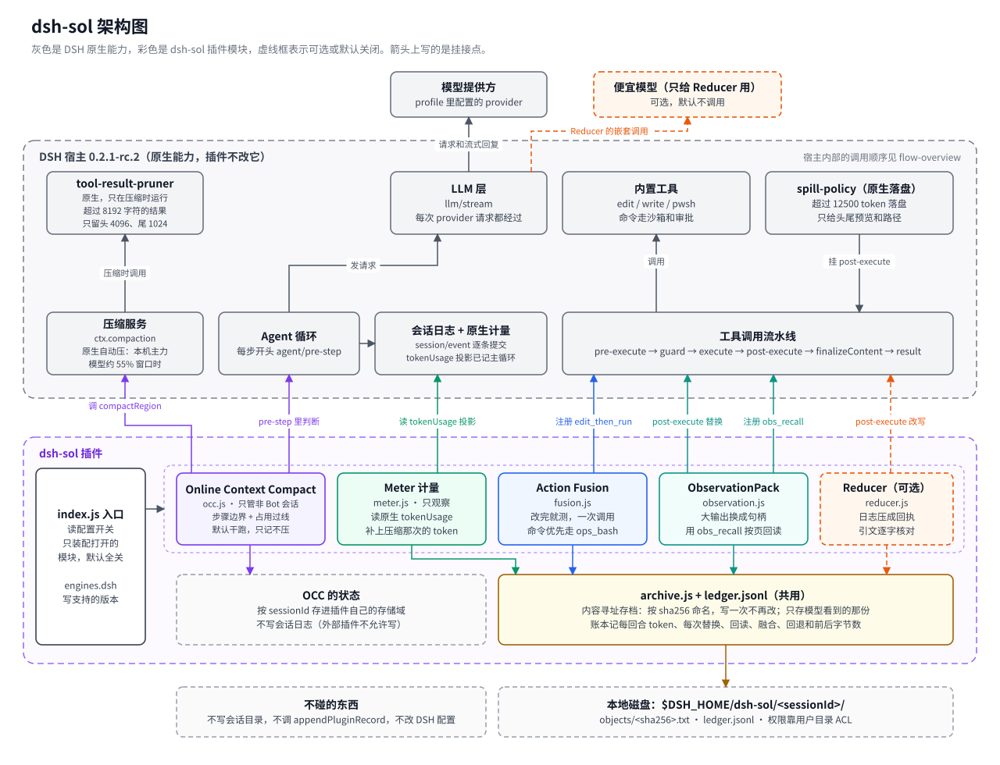

# dsh-sol 项目说明：做什么、每个功能干什么

## 项目是做什么的

dsh-sol 是一个 DeepSeek Harness（DSH）插件，目标是让智能体用**更少的 token、更少的模型往返**完成同样的任务，同时**不丢证据**：凡是被压缩或替换掉的内容，原文都有存档，可以精确取回。

思路来自 NVIDIA 的 SoL-Pi（MIT），它是 Pi 编程智能体的一个扩展。SoL-Pi 依赖 Pi 的扩展 API，DSH 没有这些 API，所以 dsh-sol 不复用 SoL-Pi 的代码，而是按 DSH 自己的插件扩展点重新实现（证据见 [report.md](report.md) 第 1 节）。

智能体费 token 主要有三个原因，dsh-sol 各有对应的功能：

| 浪费来源 | 例子 | 对应功能 |
|---|---|---|
| 不必要的往返 | 改完文件，要等下一轮才能跑测试 | Action Fusion |
| 大段输出被反复重发 | 一份 30 KB 的日志，之后每次请求都带着它 | ObservationPack、Reducer |
| 上下文越积越长 | 已经做完的步骤一直占着窗口 | Online Context Compact |

另有一个**计量**模块，记录每次模型请求用了多少 token，用来证明到底省了多少。

所有功能都**默认关闭**，要在配置里逐个打开。

**现在的状态（2026-10-19）**：五个功能都写完了，439 条测试全过（`npm test` 口径；其中 438 条是真实用例，多出的 1 条来自辅助模块 `test/fake-ctx.js`）。每个功能都在真实 DSH 里跑过，也测过和 dsh-ops 一起装，结果见 [report.md](report.md) 第 5 节。还没测“到底省了多少”，那要做 A/B。代码已经开源到这个仓库。

## 每个功能的具体作用

### 0. 计量（Meter），推荐第一步做

- **作用**：每回合结束记一行：输入、缓存命中、缓存写入、输出各多少 token，外加压缩那次花了多少。
- **为什么先做**：不改任何行为，只做观察。后面每个功能“省没省”，都靠它的数据，拿开关两组的结果对比。
- **DSH 挂点**：读 DSH 自带的 `tokenUsage` 投影，再从会话事件里补上压缩那次的 token。不包 `llm/stream`，因为 ds-bot 会把请求重发一遍，包在那里会重复计数。

### 1. Action Fusion：改完就测，一步到位

- **作用**：模型写文件或改文件时，可以顺带给一条校验命令，比如 `pnpm test`。插件写完文件就立刻跑这条命令，把“写入结果 + 命令输出”一起返回。原来要两轮，现在一轮。
- **安全**：
  - 写入失败时，命令不跑；
  - 写入后文件又被别处改了，命令也不跑；
  - 命令走 DSH 的沙箱和审批规则。
- **DSH 挂点**：注册新工具 `edit_then_run` / `write_then_run`。工具内部用嵌套的 `ctx.tools.execute` 先调 DSH 原有的 edit/write，再调 shell 执行命令，两步都照常走审批。shell 优先用 dsh-ops 的 `ops_bash`，没有就用内置 pwsh；返回值读不懂的 shell 会跳过。命令没跑成（被拒、被策略拦下、没有可用的 shell、shell 起不来）时，返回 `[then_run:not_run]` 和原因。只有退出码是 0 才算成功，缺退出码不算。
- **适用范围**：只在 native 模式下有用，PTC 模式里 `run_code` 本来就能连着调。v1 不包 dsh-ops 的 `ops_replace`。
- **论文数据**：模型轮次 −10.8%，token −11.5%（论文作者的估计，不是我们测的）。

### 2. ObservationPack：大段输出换成句柄

- **作用**：工具输出超过约 10 KB 时，原文存进本地存档，上下文里换成一个固定的短占位符，里面有句柄、大小、开头和结尾片段。模型需要细节时，用 `obs_recall` 工具按页精确读回原文。
- **和 SoL-Pi 原版的区别**：原版是前两次请求照发全文，第三次起才换占位符。DSH 不能在发请求前改消息，所以推荐的做法是工具结果一回来就换成占位符。如果要保留“先给全文”，只能事后持久替换旧结果，而这条路有政策风险（见 [report.md](report.md) 2.2 节）。
- **和 DSH 已有能力的关系**：
  - DSH 已有能力：超过 12500 token（约 50 KB）的输出会落盘，模型只看到头尾和文件路径。
  - 本功能的增量：
    - 覆盖 10–50 KB 这一段；
    - 存档稳定，不放在临时目录里，换进程也不会丢。
- **状态**：已做，默认关。阈值默认 10240 字节，输出第一次超过就换。值不值得常开，看 A/B 的数据。

### 3. Evidence-Preserving Reducer：长日志压成带原文引用的回执

- **作用**：构建或测试的日志很长时（比如 pytest 的输出），交给一个便宜的模型，压成一份简短回执，里面是成功或失败的状态，加上几条关键原文和行号。回执里每一句引文都必须和原文**逐字一致**，插件会确定性地逐条核对，有一条对不上就整份作废，保留原日志。原日志另存档，可以取回。
- **触发条件**：只管 shell 命令失败、输出不少于 4 KiB、没被截断、看着不含密钥的情况。装了 dsh-ops 时，ops_bash 超过 64000 字节就截断，所以实际只处理 4 KiB 到 64000 字节之间的失败日志。
- **风险**：日志会发给远程模型，日志里可能有密钥或内部信息。所以必须显式配 provider 和 model 才会外发，看着像密钥的一律不发。
- **状态**：已做，默认关。真机上用 glm-5.3-flash 测过：一份 20 KB 的失败日志压成 1.2 KB 的回执，多花大约 3.4 秒。正式用哪个模型还要定。

### 4. Online Context Compact（OCC）：步骤完成时按成本提前压缩

- **作用**：智能体按计划（todo）执行，每完成一个步骤，插件看一眼上下文占了多少。超过触发线就调 DSH 自己的压缩，压完同一轮接着干活。触发线是 `min(thresholdRatio × 窗口, 0.85 × 原生触发线)`，默认比 DSH 自带的更早。
- **和 DSH 已有能力的关系**：DSH 自带自动压缩，但只在上下文快满时才触发。OCC 的增量是在**步骤边界**提前压缩。
- **v1 没做的**：SoL-Pi 原版那种“算账”（压缩花多少、后面省多少），因为本机几个模型的缓存计价没核实。v1 只看占用有没有过线。
- **默认先试运行**：`dryRun: true` 时只在账本里记“这里会压”，不真压。要真压得改成 `false`。
- **真机发现**：1M 窗口的模型，触发线要几十万 token，短会话碰不到；压完以后摘要里的进度会落后一拍，这是 DSH 原生摘要的行为。
- **适用范围**：只管非 Bot 会话。Bot 会话的压缩由 ds-bot 接管，外部调用会被拒绝。所以 OCC 排在最后做。

---

## 架构图和流程图

在浏览器里打开 [diagrams.html](diagrams.html) 可以一次看全部图。单张图在 [diagrams/](diagrams/) 下，`.svg` 是源文件，`.png` 是渲染好的预览。

| 图 | 内容 |
|---|---|
| [architecture.svg](diagrams/architecture.svg) | 插件各模块挂在 DSH 的哪个扩展点上，数据存在哪 |
| [flow-overview.svg](diagrams/flow-overview.svg) | 一步 agent 循环里，各模块在哪里插手 |
| [flow-fusion.svg](diagrams/flow-fusion.svg) | Action Fusion：改完就测，以及 skipped、not_run、failed 几种出口 |
| [flow-observation.svg](diagrams/flow-observation.svg) | ObservationPack：存档并替换，按页回读 |
| [flow-reducer.svg](diagrams/flow-reducer.svg) | Reducer：日志压成回执，逐项校验，不过就保留原结果 |
| [flow-occ.svg](diagrams/flow-occ.svg) | OCC：步骤边界上算账，决定压不压 |
| [coexist.svg](diagrams/coexist.svg) | 和 dsh-ops、ds-bot 共存：7 个冲突点、dsh-sol 的做法和五条防护规则 |

## 怎么证明省了 token，又没丢证据

- **省 token**：准备一组固定任务，每个都从同一个 commit 开始。插件关、开两组各跑 N 次，用计量账本和会话 usage 对比请求数、token、成本和通过率。通过率不降，省下的 token 才算数。
- **没丢证据**：写不调模型的确定性测试。
  - 分页回读拼起来，要和原文逐字节相等。
  - 每条引文都必须是存档原文的精确子串。
  - 写入失败时，校验命令一次都不跑。
